<div class="cover">
<h1>Adaptive NPC</h1>
<h2 class="sub">An enemy that learns how you play</h2>
<p>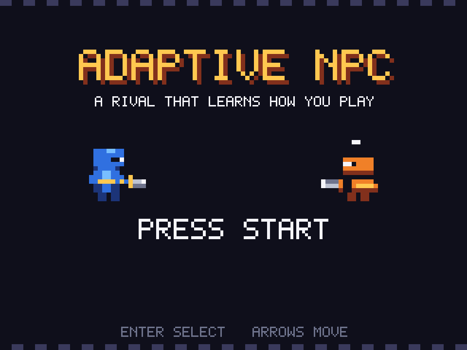</p>
<p><b>Project report: RL course mini project (B.Tech, Semester 7)</b></p>
<p>[NAMES / ROLL NOS / GUIDE / INSTITUTION]</p>
<p>[TODO: need number] (submission date)</p>
</div>

<p class="pb"></p>

## Contents

1. Introduction: the problem and what we built
2. Background: the few ideas you need
3. The game: arena, enemies and balance
4. System design: how the NPC thinks
5. Implementation: how we built it
6. Experiments and results
7. Human evaluation *(planned, results to be added)*
8. Discussion, limitations and future work
9. Conclusion
- Appendix A: setup and run commands
- Appendix B: repository structure
- Appendix C: every number in this report and where it comes from

> **Reading tips.** A *win rate* is always from the NPC's side, and a drawn round counts as half a win. "± x" is a
> 95% confidence interval: if it contains zero, we do not call the difference real.


## 1. Introduction

### 1.1 The problem: enemies you can read like a book

Think of any game where an enemy always charges when you get close, or always blocks right after it attacks. For the
first few fights that is fun. Then you notice the pattern, you beat it every time, and the enemy stops being a
challenge. The designer wrote a script, and the script never changes, because the enemy has no idea what *you* are
doing.

Real players are not like that. They get a feel for their opponent, guess what comes next, and change tactics when
the opponent changes. We wanted an NPC (non-player character) that plays that way.

### 1.2 Our goal

An NPC that

1. **watches** what a player does,
2. **predicts** the player's next move,
3. **counters** it with a better move, and
4. **adapts** when the player changes style in the middle of a match.

We based the idea on one research paper, *Model-Based Opponent Modeling* (MBOM) by Yu et al. (NeurIPS 2022). We did
not copy its experiments. We rebuilt its main ideas, scaled down, inside a small fighting game of our own, so we could
test them against many kinds of opponents and let real people play against the result.

### 1.3 What we built

| piece | in one line |
|---|---|
| **The game** | A 1v1 duel on a 9×9 grid with 8 actions: move, attack, block, dodge. It has a retro pixel-art look and sound. |
| **Five named enemies** | From a Training Dummy up to ECHO, our most advanced NPC. You can play against all of them. |
| **A predictor** | A small neural network that reads the last 8 steps and guesses the player's next action. |
| **Four NPC brains** | Hand-written, plain RL, RL with prediction, and a scaled-down MBOM. |
| **Test opponents** | Scripted styles, players that learn during a match, "exploiters" trained to beat our NPC, and a one-step-ahead planner. |
| **A demo panel** | A live display of what the NPC thinks you will do next. |
| **An experiment pipeline** | Fixed seeds, saved results, and pass/fail rules written down *before* the main runs. |

### 1.4 What we found, in plain words

> **Short version.**
> - **Predicting the player works.** On most scripted styles the predictor is right about 9 times in 10, far better
>   than simple guesses.
> - **A predicting NPC beats a hand-written one.** The reinforcement-learning NPCs beat the hand-written NPC clearly.
> - **MBOM's "imagination" did not help.** The full MBOM did not beat its simpler versions against any opponent we
>   tried. In a few groups it was slightly worse.
> - **One small gain is real but is not from imagination.** A version of MBOM with imagination switched off beat the
>   plain prediction NPC by a small amount. That comes from how MBOM retrains its predictor, not from imagination.
> - **The mixing step helps.** Weighing the imagined opponents with Bayes' rule beats weighing them equally.
> - **Real players are untested so far.** The human study is designed and the code is ready. Its results are still to
>   come (Chapter 7).

Chapters 6 and 8 give the evidence and our best explanation of why imagination did not pay off.


## 2. Background

### 2.1 Reinforcement learning in a few words

In **reinforcement learning (RL)** an *agent* learns by trial and error. It sees the situation, picks an action, and
gets a score (the *reward*). Over many tries it adjusts its decision rule (its *policy*) to collect more reward. A
*value function* is the agent's own estimate of "how well am I doing from here".

We train our NPCs with **Proximal Policy Optimization (PPO)** (Schulman et al., 2017). PPO collects experience with
the current policy, improves it in small steps, and limits how far one update may move it, which keeps training
stable. We use the Stable-Baselines3 version for offline training, plus a small PPO of our own for opponents that
learn *during* a match.

### 2.2 Opponent modelling

In a duel, the best move depends on what the other player will do. **Opponent modelling** means building a model of
the other player and using it to choose better moves (see the survey by Albrecht and Stone, 2018). Our NPCs sit at
three levels:

1. **No model:** react to what you see now. (Our plain PPO NPC.)
2. **Predict the opponent:** guess their next action from their recent behaviour and use the guess when deciding.
   *Opponent Modeling in Deep Reinforcement Learning* (He et al., 2016) is an early example of giving a deep RL agent
   a representation of its opponent. (Our prediction NPC.)
3. **Model an opponent who also thinks:** "the NPC expects me to attack, so I will block". Now the agent has to reason
   about the opponent's reasoning, possibly several levels deep. (MBOM.)

### 2.3 The MBOM paper

*Model-Based Opponent Modeling* (Yu et al., NeurIPS 2022) starts from a simple point: an agent cannot know in advance
how clever its opponent is. So MBOM keeps several guesses at once and keeps checking which one fits. It has four
parts:

1. **An environment model:** a learned network that predicts what happens next, so the agent can imagine short futures
   without touching the real game.
2. **A level-0 opponent model:** a network trained on the opponent's real past actions to predict the next one. (The
   paper calls these opponent models *imagined opponent policies*.)
3. **Recursive imagination:** to build level 1, ask "if the opponent knew the agent reacts to the level-0 guess, what
   would the opponent's best move be?". Try each opponent action in the environment model, roll a few steps ahead,
   and score the result from the opponent's side. The best actions become the training targets for level 1. Level 2 is
   built on level 1, and so on.
4. **Bayesian mixing:** after each real opponent action, check how likely it was under each level, update a belief
   with Bayes' rule, and act on a weighted mix of the levels' predictions.

The agent's own policy is trained beforehand and then **frozen**. Only the opponent models and the mixing weights
change during play. The paper also tests versions with one part removed (ablations), and we built all of those. Our
copy of the paper has no appendices, so its hyperparameters were not available to us; all our settings are our own.


## 3. The game

### 3.1 Arena and rules

Two fighters duel on a **9×9 grid**. Each has **5 HP** and **6 stamina**. Both pick an action at the same time and
the game resolves them together.

| action | what it does |
|---|---|
| idle | do nothing |
| up, down, left, right | move one tile and face that way |
| attack | hit the tile in front for 1 damage, then wait 2 steps before the next attack |
| block | guard the front only; costs 1 stamina per step |
| dodge | dash up to 2 tiles, untouchable for that step; costs 3 stamina |

A few rules make the actions trade off:

- **Parry:** attack someone who is blocking you from the front and nothing happens, except that *you* are stunned for
  2 steps.
- **Stamina** comes back 1 point every 2 steps. If you can't afford a block or dodge, you just stand still.
- A **round** ends at 0 HP or after **150 steps**. At the time limit, the fighter with more HP wins; equal HP is a
  draw. A **match** is **30 rounds** by default.
- **Reward** for the NPC: +1 win, −1 loss, 0 draw, plus ±0.1 per point of damage dealt or taken to make learning
  easier. The game is zero-sum.

The NPC sees 21 numbers (positions, facings, HP, stamina, cooldowns, stun timers, time in the round). The player's view
is the exact mirror, so any style can play either side.

### 3.2 The rock-paper-scissors loop

No action is always best:

- **Attack beats moving:** step in front of an opponent and you get hit.
- **Block beats attack:** the attacker is stunned.
- **Flanking or waiting beats block:** a block only covers the front, and holding it drains stamina.

Dodge sits outside the triangle: it escapes any attack but costs half the stamina bar. Because every action has a
counter, knowing the opponent's next move is *useful*, which is exactly what a predicting NPC needs.

### 3.3 The retro game shell

For people to play, we built a separate front end with Pygame. It only reads the game state and draws it, never
changing the rules. Everything is drawn on a 320×240 canvas with a fixed 16-colour palette and scaled up to a
960×720 window. The sound effects and two chiptune tracks are generated in code, so there are no audio files.

<table class="pair"><tr>
<td></td>
<td>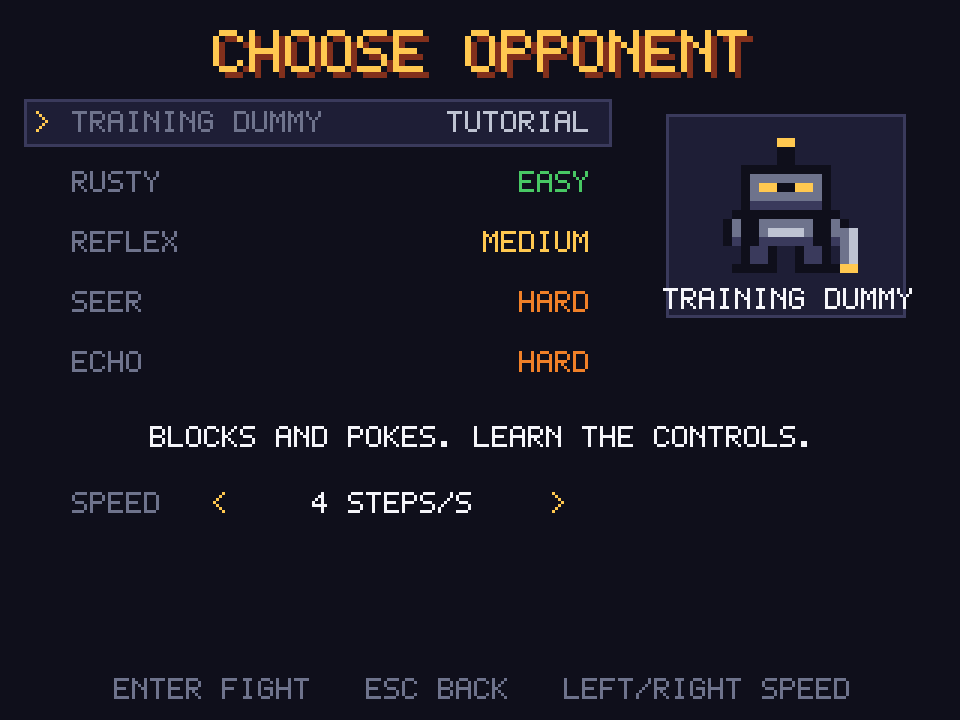</td>
</tr></table>

*Figure 3.1. The title screen (left) and the opponent-select screen (right). Each enemy has a difficulty tag.*

Controls are WASD or the arrow keys to move, J to attack, K to block and L to dodge. The game runs at **4 steps per
second** for human play by default (we lowered it from 8 after the first play-test found 8 too hard) while the screen
redraws at 60 frames per second. This only affects human play; training and evaluation run as fast as the computer
allows.

### 3.4 Meet the enemies

The select screen offers five enemies. Each is one of our NPC brains with a name and a look.

| enemy | what it really is | tag | personality |
|---|---|---|---|
| **TRAINING DUMMY** | the camper archetype | TUTORIAL | blocks and pokes; good for learning the controls |
| **RUSTY** | hand-written scripted NPC | EASY | hand-coded tactics that never change |
| **REFLEX** | plain PPO (`ppo_none`) | MEDIUM | trained fighter, fast but predictable |
| **SEER** | PPO + predictor (`ppo_predicted`) | HARD | guesses your next move and counters it |
| **ECHO** | MBOM | HARD | tries to adapt when you change your style |

The tags order the enemies by how sophisticated they are. They have **not** been measured against people. ECHO has the
same tag as SEER on purpose, because our results do not show MBOM to be stronger than `ppo_predicted`.

### 3.5 The demo panel: watch the NPC think

Press **Tab** during a fight to open the demo panel. It shows the NPC's guess for each of your 8 possible next
actions as a bar, highlights the action you actually took, and keeps a running prediction accuracy. Against ECHO it
also shows the mixer weights (α) for its three opponent-model levels, with the 0.79 cap marked.

<table class="pair"><tr>
<td>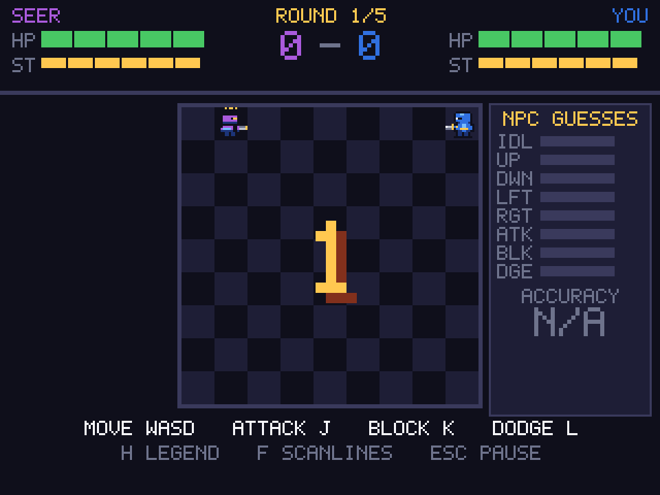</td>
<td>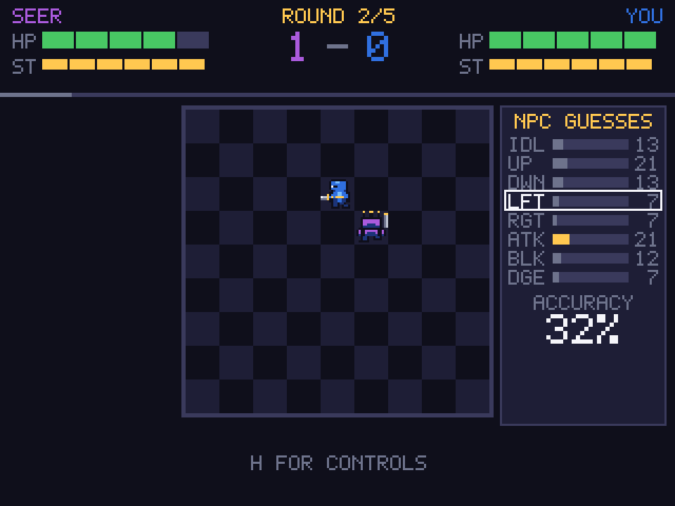</td>
</tr></table>

*Figure 3.2. A match against SEER. Left: round start, the panel has nothing to show yet (accuracy N/A). Right: mid-fight,
the NPC's guesses are drawn as bars on the right, and the highlighted row is the action the player really took.*

<table class="pair"><tr>
<td>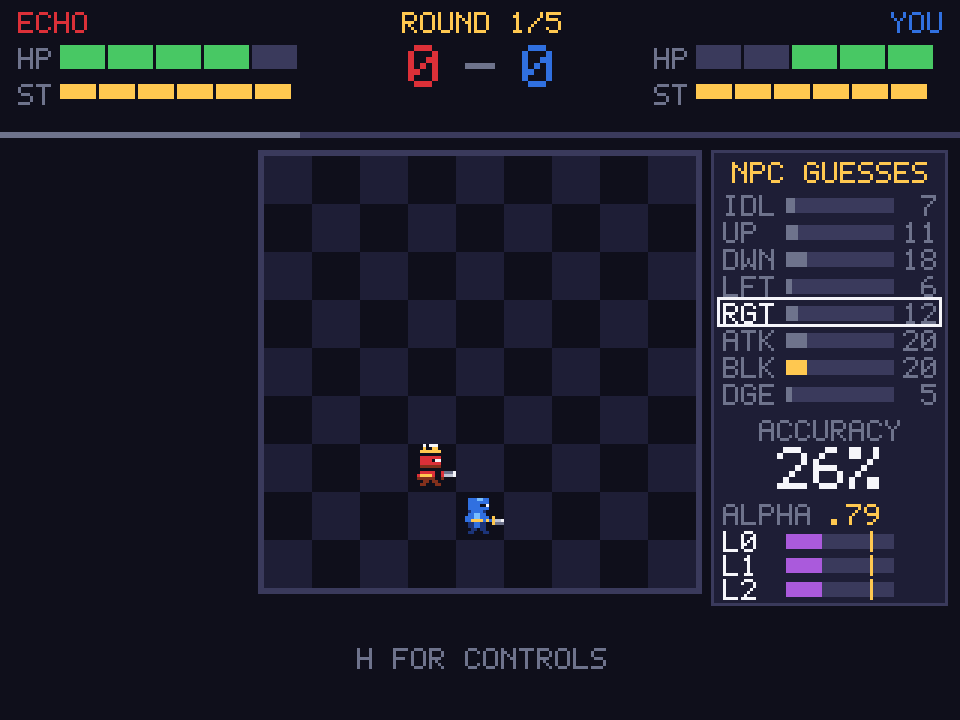</td>
<td>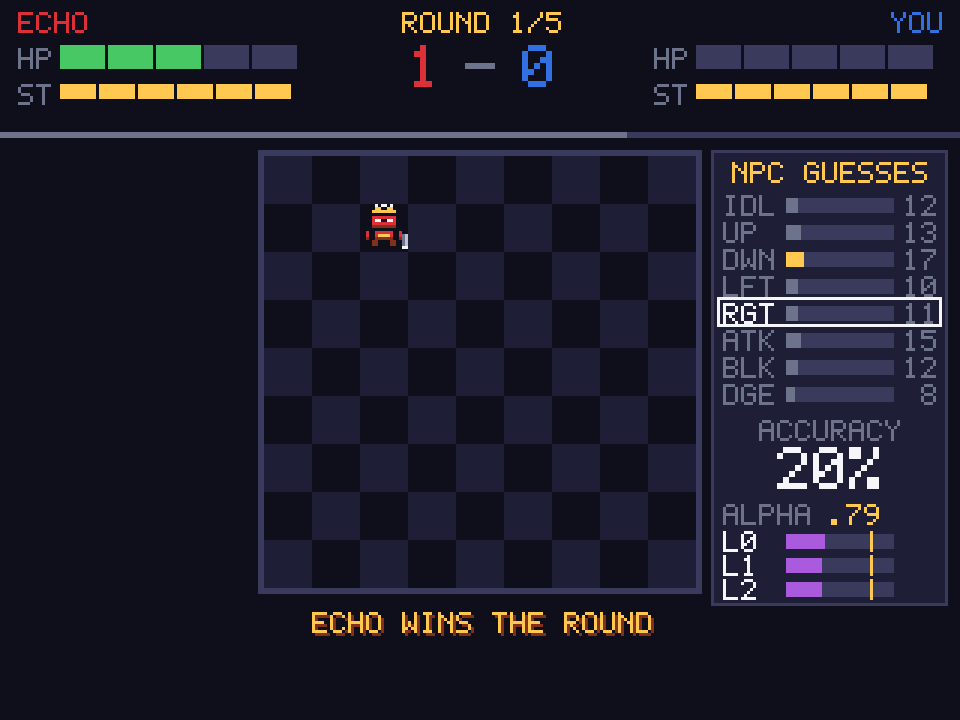</td>
</tr></table>

*Figure 3.3. A match against ECHO. Below the guesses, the ALPHA section shows the weights on the three levels L0, L1 and L2.
The small yellow tick on each bar is the 0.79 cap. In the left frame the weights are still close to equal.*

**Blind mode.** `--blind` hides enemy names and the panel, gives every enemy the same look and sound, and logs which NPC
was really played. It exists for the human study.

**A caveat about ECHO.** An MBOM update takes about 3 seconds. To keep the game smooth, the playable ECHO runs its update
in a background thread, so the result arrives a few steps late and an update is skipped if the last one hasn't
finished. The playable ECHO is therefore only an **approximation** of the MBOM we evaluated. All MBOM numbers in this
report come from the synchronous version, which the game can also run (`ui.mbom_async=false`), with short pauses.

### 3.6 Is the game fair? The balance check

Before training anything we checked that no scripted style beats everything. If one did, "find the counter-strategy"
would have a boring answer. We ran a round-robin between 10 players (the 8 scripted archetypes from Section 4.1, the
hand-written NPC and a random player): 200 rounds per pair per seed on each side, seeds 0–2. We fixed four checks
first:

1. No side bias: a mirror match is 45–55% for either slot.
2. No style wins 65% or more against every other.
3. Every style wins at least one matchup and loses at least one.
4. Every style has a counter that beats it at least 60% of the time.

**The first run failed.** The counter-puncher (block, then punish) won almost everything: 1.000 against the rusher and
0.999 against the kiter. A diagnosis showed the rules already allow a counter, because a side attack gets past a block.
So we changed the players, not the rules: we added the **flanker** (attacks from the side) and made the counter-puncher
react one step late with 20% random actions. After that all four checks passed. Every tuning step is logged in
`results/balance/log.md`.

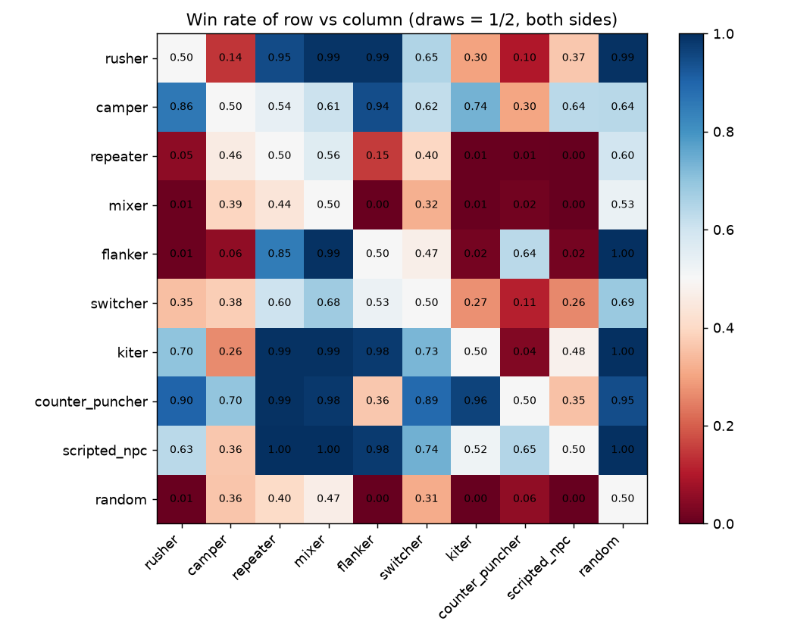

*Figure 3.4. Win rate of the row player against the column player, draws = ½. Each style beats some and loses to
others. Source: `results/balance/winrate_matrix.csv`.*

Mirror matches came out between 0.4825 and 0.5058. Examples of counters: the counter-puncher beats the rusher 0.90 and
the kiter 0.96; the scripted NPC beats the counter-puncher 0.65; the camper beats the scripted NPC 0.64.

**Known imperfections.** The balance is not perfect, and we say so plainly:

- The **flanker is weak overall**: it beats the counter-puncher (0.636), repeater and mixer, but loses to most others
  (0.010 against the rusher).
- **Passive styles mostly draw** against each other (Figure 3.5). 20 pairs, mirror pairs included, draw more than half
  their rounds, so their win rates sit near 0.5.
- The **counter-puncher still wins 90% or more against predictable styles** (0.902 against the rusher, 0.994 against the
  repeater). It is not dominant because the flanker and the scripted NPC beat it, but lowering this would need a change
  to its logic.

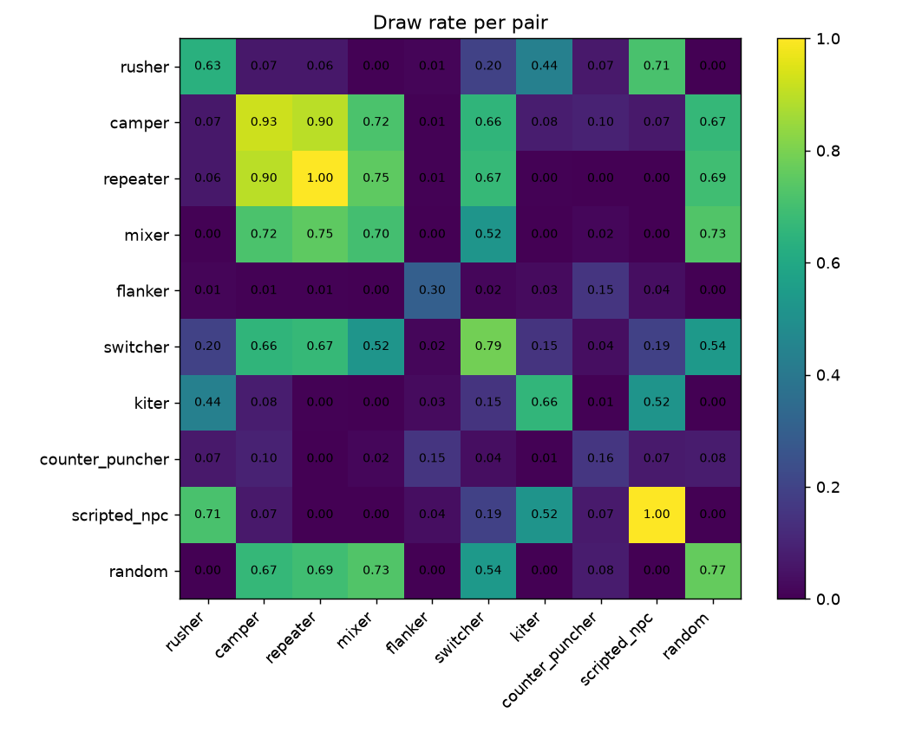

*Figure 3.5. Share of drawn rounds per pair. Source: `results/balance/draw_rate_matrix.csv`.*


## 4. System design

Figure 4.1 shows how everything fits together. The game core does not care who is playing: every NPC and every opponent
plugs into one of its two sides.

```
                     +---------------------------------------------+
                     |  Game core (rules only, no graphics)         |
                     |  9x9 grid, 8 actions, HP, stamina, parry     |
                     +-------------+-----------------------+-------+
                                   |                       |
          NPC side                 v                       v        opponent side
 +-------------------------------------------+   +--------------------------------+
 | scripted NPC     hand-written rules        |   | 8 scripted archetypes          |
 | ppo_none         PPO on the observation    |   | naive / reasoning learners     |
 | ppo_predicted    PPO + predictor output    |   | exploiters (frozen)            |
 | MBOM             frozen ppo_predicted      |   | lookahead opponent             |
 |                  + mixed opponent models   |   | human (keyboard)               |
 +---------------------+---------------------+   +--------------------------------+
                       |
   MBOM during a match v
 +-------------------------------------------------------------------------------+
 | real opponent actions --> phi0 (GRU predictor, fine-tuned on real actions)    |
 | env model Gamma + imagination:                                                |
 |    opponent best response to NPC-using-phi0 --> trains phi1                   |
 |    opponent best response to NPC-using-phi1 --> trains phi2                   |
 | phi0, phi1, phi2 --> Bayesian mixer (weights alpha) --> mixed prediction      |
 |                  --> frozen PPO policy --> NPC action                         |
 +-------------------------------------------------------------------------------+
 Pygame shell, demo panel and sound only read the game state.
```

*Figure 4.1. Block diagram of the system.*

### 4.1 The opponents we test against

**Scripted archetypes** are short hand-written rules, most with 5% random actions so they are not perfectly
predictable.

| style | how it plays | used for |
|---|---|---|
| **rusher** | charges and attacks whenever it faces you | training |
| **camper** | stays put, blocks when you come within 2 tiles, pokes 30% of the time | training |
| **repeater** | a fixed 8-step loop: toward, toward, attack, idle, block, block, away, dodge | training |
| **mixer** | picks random actions with fixed odds (25% attack, 20% block) | training |
| **flanker** | walks to your side and attacks there, where a block doesn't help | training |
| **switcher** | changes style every 10 rounds: rusher, camper, repeater, mixer | training; tests style changes |
| **kiter** | hits, then backs off while its attack recharges | held out (testing only) |
| **counter-puncher** | blocks at close range and punishes after you attack | held out (testing only) |

The **hand-written NPC** is the baseline we want to beat: close in, attack when ready, block while the attack
recharges. No randomness.

**Learning opponents.** A fixed style can't tell us how the NPC copes with a player who *learns*, so we built two:

- The **naive learner** is a PPO policy **pretrained against the hand-written NPC** that keeps learning during a
  match.
- The **reasoning learner** does the same, and also keeps its own model of the NPC and uses that model's prediction in
  its decisions.

We picked their online learning settings with a small sweep (3×10⁻⁴, 10⁻³ and 3×10⁻³, updating every 32 or 64 steps),
choosing the smallest setting that changed the policy, still beat a random player, and did not collapse: learning
rate 3×10⁻⁴, an update every 64 steps. Two things matter later. Their pretraining against the hand-written NPC gives them
a head start against that NPC. And a 30-round match gives them only about 600–1,000 steps of experience, which is not
much time to adapt.

**Exploiters.** To see whether our best NPC can be beaten by an opponent that knows its weaknesses, we trained three
**exploiters** (seeds 0, 1, 2). Each starts from the pretrained naive learner and trains offline for **1 million steps**
against one frozen `ppo_predicted` NPC (the checkpoint with seed 0). In evaluation they are frozen. `exploiter_seed1` is
the **development** exploiter, used for tuning and go/no-go checks only; `exploiter_seed0` and `exploiter_seed2` are used
for the **final claims**. All three were trained against NPC seed 0, so results at NPC seed 0 and at seeds 1–4 are
always reported separately.

**Lookahead opponent.** For one test (H2, Chapter 6) we built an opponent that reasons exactly the way MBOM's level 1
imagines. Each step it assumes the NPC is plain `ppo_predicted`, predicts the NPC's move, tries each of its own actions
two steps ahead in the true rules, and plays the best one (5% of its actions are random). It does not learn, and its
settings were fixed before the test and not tuned afterwards.

### 4.2 The player predictor

The predictor is the part that "learns the player's habits". For each of the last **8 steps** it reads the NPC's
observation plus the previous NPC and player actions. A single-layer **GRU** (64 units; a recurrent network with a
short memory) turns that into a probability for each of the player's 8 next actions.

It is trained offline on play between the training archetypes and two NPCs (the hand-written NPC and a random one). It
then keeps learning during a match: every 25 steps it takes 3 small training steps on the most recent 256 examples.
We chose those online settings with a sweep over seven options.

### 4.3 The four NPC brains

| brain | decides from |
|---|---|
| `scripted` | hand-written rules |
| `ppo_none` | PPO looking only at the 21-number observation |
| `ppo_predicted` | PPO looking at the observation **plus** the predictor's 8 probabilities |
| `mbom` | the frozen `ppo_predicted` policy, fed a *mix* of three opponent models instead of one prediction |

A debug brain, `ppo_oracle`, is told the player's *true* next action. It shows the ceiling for any prediction-based NPC
and is never presented as a real method.

Each PPO brain trains for 2 million steps against the training archetypes (a new one each round), with two small
64-unit layers for policy and value, over 5 seeds. In evaluation they act greedily. In the MBOM experiments
`ppo_predicted` also fine-tunes its predictor online, so it is a fair baseline for MBOM.

### 4.4 The environment model Γ

MBOM needs a model of the game to imagine futures in. Our learned model **Γ** (Gamma) takes the full game state (15 whole
numbers: positions, facings, HP, stamina, cooldowns, stun timers, step count) plus both actions, and predicts the next
state and the reward.

Because every part of the state is a small whole number, Γ treats each one as a choice ("does HP change by −1, 0 or
+1?") and snaps its answer to a legal state before using it again, so errors can't drift into impossible states. It
learns the small damage part of the reward; the ±1 win/loss part is computed from the predicted next state. Our first
version predicted the reward as one number and got 0% of the end-of-round rewards right, which is why we split it.

Γ trained on recorded play between many NPCs and many opponents (86.7k transitions, with 34.3k for validation and 23.2k
against opponents it never trained on), plus 57.7k random-action transitions, 40% of the training mix, so it also knows
unusual situations.

### 4.5 MBOM in our game

MBOM's policy is the frozen `ppo_predicted` policy. Instead of the predictor's single guess it receives a weighted mix of
three opponent models. Only those models and the weights change during a match.

- **φ0 (level 0)** is the pretrained predictor, fine-tuned on the opponent's real actions every **50 real steps** with
  learning rate **10⁻³**. This is a different schedule from `ppo_predicted`'s own (every 25 steps at 3×10⁻⁴), and that
  difference turns out to matter.
- **φ1 and φ2** start each match as copies of φ0. At each update, φ1 learns the opponent's *best response to an NPC that
  trusts φ0*, and φ2 learns the best response to an NPC that trusts φ1.

**Imagination, step by step.** For each recent real state and each of the opponent's 8 actions: (1) the opponent plays
that action and the NPC answers with its frozen policy; (2) Γ rolls the game **2 more steps** with random opponent moves,
**16 times**; (3) each rollout is scored from the opponent's side; (4) the action's score is its best rollout. The
scores become soft training targets for the level.

**The Bayesian mixer.** After each real opponent action the mixer checks how likely the action was under each level,
updates a belief with Bayes' rule, smooths it over time, and sets the weights α with a softmax at temperature T = 0.5.
The policy receives α₀·φ0 + α₁·φ1 + α₂·φ2.

> **The α cap.** With T = 0.5 the largest weight any level can get is about **0.787**, even when the mixer is
> completely sure. So the mixer can never fully commit: the other two levels always keep about 21% between them. We
> found this while building the mixer and kept the configured value. It turns out to matter (Chapter 6).

On synthetic data with a known answer (20 seeds) the mixer behaved as designed: the true level took the lead for good by
step 17, and after a switch the new level took the lead after a median of 50 steps when the levels overlapped strongly.

**Variants for the ablations.**

| variant | what changes |
|---|---|
| `mbom_no_imagination` | only φ0 is used, still fine-tuned on MBOM's schedule |
| `mbom_uniform_mix` | equal weights on all levels instead of the Bayesian mixer |
| `mbom_single_level1` / `_level2` | all weight on one imagined level |
| `mbom_random_finetune` | levels trained on random actions instead of best responses |
| `mbom_top_level` | the policy sees the highest-weighted level alone instead of the mix |

Comparing `mbom` with `no_imagination` isolates **what imagination adds**. Comparing `no_imagination` with
`ppo_predicted` isolates **what MBOM's φ0 schedule adds**. All mixer and imagination tuning used only the development
set (the training archetypes and `exploiter_seed1`).


## 5. Implementation

### 5.1 Stack and working rules

Everything is Python and runs **locally on a CPU**. There are **no external APIs or online services**.

| for | we used |
|---|---|
| neural networks (predictor, Γ, MBOM) | PyTorch |
| environment interface | Gymnasium |
| offline PPO training | Stable-Baselines3 |
| game window and sound | Pygame |
| data, statistics, plots | NumPy, SciPy, pandas, Matplotlib |
| configs and tests | PyYAML, pytest |

We worked by a few rules:

- **Rules apart from drawing.** The game core never imports Pygame, so training runs fast without a window.
- **No settings in code.** Every seed and hyperparameter is in a YAML config.
- **Reproducible runs.** Fixed seeds; every run saves its results with a copy of its config and the git commit hash.
- **Small steps.** Milestones M0–M14 in `PLAN.md`, each built, smoke-tested with a one-minute config, then committed.
- **Pre-registration.** For the MBOM tests, the pass/fail rule was written down before any run.

### 5.2 The build, step by step

| step | what we did |
|---|---|
| Game core and rules | Wrote the arena, tested every rule, and made sure the same seed always gives the same game. |
| Scripted players and the baseline NPC | Eight styles plus the hand-written NPC; a test checks each behaves differently. |
| Game balance | The round-robin from Section 3.6, with tuning until it passed. |
| Rendering and human play | The Pygame front end, later the retro shell, sound and demo panel. |
| Predictor | Collected play data, trained the GRU, added online fine-tuning. |
| PPO NPCs | Trained `ppo_none`, `ppo_predicted` and the oracle over 5 seeds. |
| Learners and exploiters | Online learners, then the exploiters trained to beat our NPC. |
| Environment model Γ | Collected transitions, trained and measured Γ. |
| MBOM | Levels, imagination, mixer, ablation switches, per-round logging. |
| Experiments | Probe, go/no-go, hypothesis tests, final grid. |
| Plots, human-study code, wrap-up | Figures, the `--blind` study runner, README, final models. |

### 5.3 Speed

Random players on both sides (`results/benchmarks/env_speed.csv`):

| setup | steps per second |
|---|---|
| game core alone | 399,288 |
| one Gymnasium environment | 121,940 |
| 8 environments in one process | 80,703 |
| 8 environments in separate processes | 27,731 |

That is far above our 10,000 steps/s target. MBOM is much heavier: one update takes about 3.0 s with 10 threads (6.3 s with
one), and a 30-round match took 23–56 s (mean 38 s) against 1.5–2.7 s for `ppo_predicted`. The final experiment grid took
about 49 process-hours, which we ran as parallel single-thread processes.

### 5.4 Testing and running

The suite has **156 tests** and runs headless in about a minute. It checks every game rule, determinism, that each
archetype behaves differently, that Γ's rollouts match the true rules, that the mixer finds the right level and respects
the cap, that imagination finds the known best response in two hand-built states (checked by brute force), and that the
shell, panel, sound and human-study logging work.

```powershell
python -m venv .venv
.\.venv\Scripts\Activate.ps1
pip install -r requirements.txt
python -m pytest -q                                  # tests
python -m scripts.play                               # play: title screen, then pick an enemy
python -m scripts.play --opponent mbom --panel on    # play ECHO with the demo panel open
```

The full command list is in Appendix A and the layout in Appendix B.


## 6. Experiments and results

All results come from saved files in `results/`; every run copies its config and git hash next to its outputs.

> **How to read the evidence.** For the final comparisons we fixed the test before running: a paired test with Holm
> correction (the "statistical verdict"), and a separate check of whether the gain is at least 0.05 in win rate (the
> "practical verdict"). The two are shown side by side. Anything whose interval includes zero is described as "no
> detectable difference", not as a result.

### 6.1 Can we predict the player?

We tested the predictor against the hand-written NPC and compared it with two simple guesses: always predict the
player's most common action ("majority"), or predict that the player repeats its last action.

| player style | predictor right | majority guess |
|---|---|---|
| rusher | 0.91 | 0.35 |
| repeater | 0.96 | 0.23 |
| flanker | 0.91 | 0.30 |
| switcher | 0.88 | 0.25 |
| camper | 0.73 | 0.55 |
| mixer | 0.22 (the best possible is 0.25) | 0.23 |
| *kiter (held out)* | 0.86 | 0.35 |
| *counter-puncher (held out)* | 0.47 frozen, 0.61 with online learning | 0.44 |

The predictor beats the simple guesses by a wide margin on every style that has a pattern. The **mixer** is the control: it
picks actions at random with fixed odds, so even a perfect predictor can be right only 25% of the time. The predictor gets
0.217, essentially at that ceiling, which shows it is not inventing patterns that aren't there. The held-out styles are
harder: the kiter is still predicted well, and the counter-puncher improves clearly once the predictor is allowed to
keep learning online.

**What happens when the player switches style?** Figure 6.1 shows predictor accuracy before and after a switch. For
switches into the rusher or the repeater, accuracy recovers within about the first 100 steps. A switch into the mixer
has nothing to recover to, as expected.

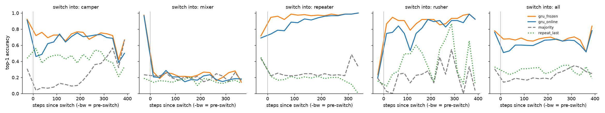

*Figure 6.1. Top-1 accuracy around a style switch, one panel per style switched into. Source:
`results/predictor/main/recovery_curve.csv`.*

Online fine-tuning does not always help. It helped most against the counter-puncher, but slightly hurt against the switcher
(0.877 frozen vs 0.850 online).

### 6.2 Does the environment model Γ get the game right?

Γ is exact on almost every step. On the validation data, the whole 15-number state is predicted exactly **99.38%** of the
time for one step and **98.79%** for two steps. On opponents Γ never saw, it is 99.29% and 98.63%. Even when both players
act completely at random it is 98.89% and 97.27%. The reward is within 0.05 on about 99% of steps. The weakest spot is the
reward on the step where the NPC is knocked out (85.9% right), where the ±0.1 damage term is sometimes missed.

Errors can pile up as imagination rolls further, and we only measured up to two steps ahead, which is also what MBOM uses.

### 6.3 NPC versions against the hand-written NPC

Against the fixed styles, both PPO NPCs beat the hand-written NPC clearly. The hand-written NPC wins only 0.563 of rounds
against the kiter and 0.683 against the counter-puncher, while both learned NPCs are above 0.90:

| NPC | vs kiter | vs counter-puncher |
|---|---|---|
| scripted | 0.563 | 0.683 |
| `ppo_none` | 0.993 | 0.903 |
| `ppo_predicted` | 1.000 | 0.973 |
| `mbom_no_imagination` | 1.000 | 0.980 |
| `mbom` | 1.000 | 0.947 |

(Held-out styles, 5 NPC seeds, 30-round matches, from the final grid.) A fair warning: **against the fixed styles, win rate
saturates near 1.0** for every learned NPC, so those opponents cannot tell the learned NPCs apart. This is why the
interesting comparisons use learners and exploiters.

### 6.4 The learners and the exploiters

**The learners.** Online learners beat the hand-written NPC and are about level with `ppo_none`, but they lose to
`ppo_predicted`. In the final grid the NPC's win rate against the naive learner is 0.051 for the hand-written NPC, 0.584 for
`ppo_none` and 0.909 for `ppo_predicted` (against the reasoning learner: 0.007, 0.767, 0.920). This comparison was
**exploratory**, not pre-registered. It also favours the learners in one way: **they were pretrained against the
hand-written NPC**, so they start strong against exactly that opponent.

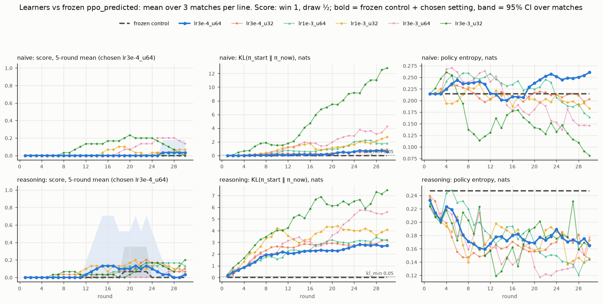

*Figure 6.2. The naive and reasoning learners playing the frozen `ppo_predicted` NPC over 30 rounds. Source:
`results/learners/main/plots/ppo_predicted.png`.*

**The exploiters.** Trained offline for 1M steps against one `ppo_predicted` checkpoint, the exploiters beat it: each
seed goes from a 0.00 win rate before training to 0.45–0.96 after. But that is a fact about *one* checkpoint. When we
tested them on NPC checkpoints they had never seen (seeds 1–4), they beat plain PPO about as much as they beat
`ppo_predicted`, and prediction gave no clear edge (`ppo_predicted` − `ppo_none` = +0.046 ± 0.130, a difference we cannot
tell from zero). Only at NPC seed 0, the checkpoint they trained against, is `ppo_predicted` much worse than `ppo_none`
(−0.311 ± 0.072). So the part of the exploit that is specific to `ppo_predicted` is mostly about that one checkpoint; the
general part hurts every learned NPC about equally, and the hand-written NPC most. (This corrects an earlier reading in
`PLAN.md` that said the exploit transferred only partly.)

### 6.5 The MBOM tests, one by one

These tests were designed before they were run. The first three are **development tests**, so they are not part of the
final claims.

**A. Is the mixed prediction safe for the frozen policy?** The frozen policy had never seen a blend of predictions. We
fed it blended and scrambled predictions and checked the win rate against the training archetypes, with the pass rule
fixed first (a drop of more than 5 points would force a change). The worst variant dropped by 1.4 points, so we kept the
mixed input. Damage taken per round did go up for a deliberately confusing blend (0.16 to 0.44 HP), yet the NPC still won.

**B. Go/no-go on the development exploiter.** MBOM had to beat `ppo_predicted` by at least 0.05 with the paired
interval above zero. It did not: **NO-GO**. MBOM beat `ppo_predicted` by 0.004 (paired 0.004 ± 0.034), and MBOM was worse
than its own no-imagination version by 0.050 ± 0.031. Imagination made things slightly worse here.

**C. Why? What the levels predict.** We looked at how well each level predicts the opponent (against the development
exploiter, late in the match):

| level | prediction accuracy |
|---|---|
| φ0 (fine-tuned predictor) | 0.783 |
| φ1 | 0.178 |
| φ2 | 0.206 |

φ0 learns the exploiter well. The imagined levels φ1 and φ2 are near chance (1/8 = 0.125) and *worse than an untouched
copy of the pretrained predictor* (0.270). Their imagined "best response" does not look like what this frozen exploiter
actually does. The mixer notices and moves almost all weight to φ0, but its cap stops it at about 0.78, so φ1 and φ2 keep
about 22% of the weight. That blurs the policy's input and flips the policy's choice on about 6% of late steps. In effect,
MBOM behaves like a blurred copy of the no-imagination version.

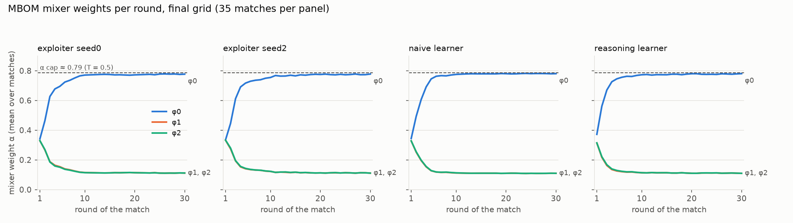

*Figure 6.3. Mixer weights α on the three levels over the 30 rounds, averaged over matches. The weight on φ0 climbs to the
cap (dashed line) by about round 6 and stays there; φ1 and φ2 share the rest. Source: `results/m11/alpha_traces.csv`.*

Two more checks narrowed it down. Using the **true game rules** instead of Γ gave the same result (+0.003 ± 0.021 against
MBOM, still behind no-imagination), so Γ's mistakes are not the cause: the idea of "best response against this
opponent" is the problem. And feeding the policy the top level alone (`top_level`) recovered the no-imagination result
(−0.003 ± 0.012), as predicted before the run. All of these are **development-set** results.

**D. H1: does imagination help against opponents that adapt?** Using the two learners and the switcher, we asked whether
MBOM beats `no_imagination`. **H1 was not supported**: pooled over 105 paired matches the difference was
−0.011 ± 0.020. Against the learners, the win rate was not saturated (0.87–0.93), so this was a fair test.

**E. H2: does imagination help against the opponent it was built to model?** The lookahead opponent plans exactly the way
MBOM's level 1 imagines. **H2 was not supported**: MBOM minus `no_imagination` was −0.007 ± 0.041. But this test has a
**floor effect**: all three NPCs won only about 10–12% of rounds (0.116, 0.122, 0.098) and lost about 4.7 of 5 HP per
round. The lookahead opponent beats all of them, so there was little room for differences. H2 tells us imagination does not
rescue the NPC against an opponent this much stronger. It does not tell us whether imagination helps against a level-1
thinker the NPC can compete with. Because H2 failed, the extra variants (`single_level2`, `random_finetune`) were **not**
run on the final grid, as the amendment written before the grid said.

### 6.6 The final grid

The final grid compares six NPCs (`scripted`, `ppo_none`, `ppo_predicted`, `mbom_no_imagination`, `mbom`, `mbom_uniform_mix`)
on 5 NPC seeds, with 7 matches per cell for the exploiters and learners. The **pre-registered claim groups** are the
exploiters: `exploiter_seed0` and `exploiter_seed2`, each at NPC seed 0 and at seeds 1–4, and pooled. Everything else is
exploratory.

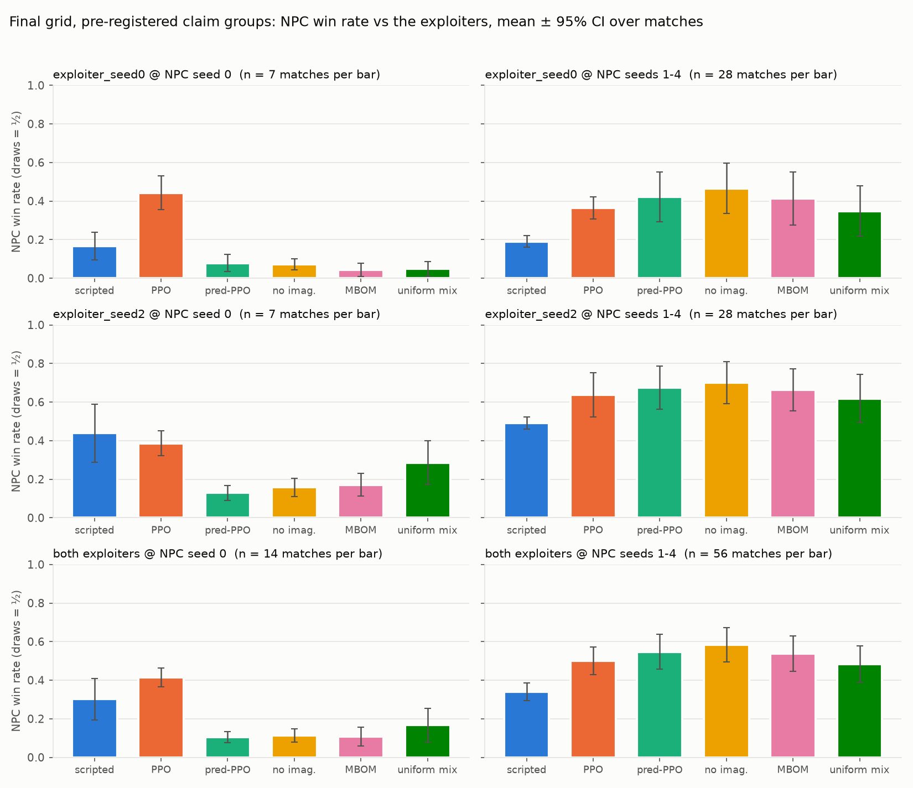

*Figure 6.4. NPC win rate against the two exploiters, one bar per NPC. Left: NPC seed 0, where the exploiters trained. Right:
NPC seeds 1–4. Source: `results/m11/claim_groups.csv`.*

The picture is clear at a glance. **At NPC seed 0, every NPC loses heavily**, with no method separating from another. **At
seeds 1–4, MBOM and `ppo_predicted` look alike**, and the small differences are shown in the table.

| group | comparison | paired difference ± 95% CI | statistical verdict (Holm) | gain of at least 0.05? |
|---|---|---|---|---|
| both exploiters @ seeds 1–4 (56 matches) | mbom − `ppo_predicted` | −0.009 ± 0.023 | no detectable difference | no |
| | mbom − `no_imagination` | −0.045 ± 0.026 | **worse** | no |
| | `no_imagination` − `ppo_predicted` | +0.035 ± 0.023 | **better** | no |
| | `uniform_mix` − mbom | −0.055 ± 0.037 | **worse** | **yes** |
| `exploiter_seed0` @ seeds 1–4 (28) | mbom − `ppo_predicted` | −0.008 ± 0.030 | no detectable difference | no |
| | mbom − `no_imagination` | −0.052 ± 0.037 | **worse** | **yes** |
| | `no_imagination` − `ppo_predicted` | +0.044 ± 0.031 | **better** | no |
| | `uniform_mix` − mbom | −0.065 ± 0.048 | **worse** | **yes** |
| `exploiter_seed2` @ seeds 1–4 (28) | mbom − `ppo_predicted` | −0.010 ± 0.036 | no detectable difference | no |
| | mbom − `no_imagination` | −0.037 ± 0.040 | no detectable difference | no |
| | `no_imagination` − `ppo_predicted` | +0.027 ± 0.036 | no detectable difference | no |
| | `uniform_mix` − mbom | −0.045 ± 0.058 | no detectable difference | no |

At NPC seed 0 (three more claim groups, 7 to 14 matches each) none of the comparisons was detectable. In plain words:

1. **MBOM vs `ppo_predicted`: no detectable difference in any claim group.** Imagination did not beat plain prediction.
2. **MBOM vs `no_imagination`: MBOM is a little worse** where there is a signal (seeds 1–4, pooled and for
   `exploiter_seed0`). The pooled gap is statistically real but below the 0.05 practical threshold.
3. **`no_imagination` vs `ppo_predicted`: a small gain** (+0.035 pooled, under the 0.05 practical bar). This gain exists
   without imagination. It comes from MBOM's different schedule for retraining φ0 (larger learning rate, every 50
   steps rather than every 25).
4. **The Bayesian mixer helps.** Equal weights (`uniform_mix`) are worse than the Bayesian mixer by 0.055 pooled, a
   statistical *and* practical gain. The mixer's job here is to turn down the weak imagined levels.

The same pattern shows up in the dev-set variants: forcing all weight onto φ1 alone (`single_level1`) lost 0.202 ± 0.050
against MBOM, and equal mixing lost 0.119 ± 0.054. (Development set only; these were not run on the final grid.)

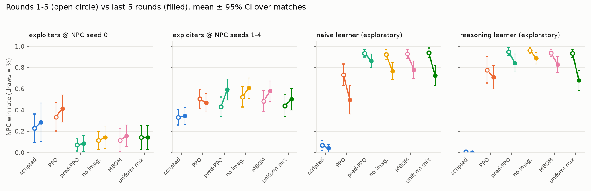

*Figure 6.5. Win rate in rounds 1–5 (open circles) against the last 5 rounds (filled) for each NPC. Source:
`results/m11/early_late.csv`.*

### 6.7 Exploratory comparisons

These were added after the final run, so they are **not pre-registered** and their p-values are not corrected.

| group | `ppo_predicted` − `ppo_none` | `ppo_predicted` − `scripted` |
|---|---|---|
| both exploiters @ seed 0 | **−0.311 ± 0.072** | −0.199 ± 0.107 |
| both exploiters @ seeds 1–4 | +0.046 ± 0.130 (can't tell from zero) | +0.207 ± 0.085 |
| naive learner | +0.325 ± 0.112 | +0.858 ± 0.031 |
| reasoning learner | +0.152 ± 0.105 | +0.913 ± 0.031 |

Against the learners, MBOM and `ppo_predicted` showed no detectable difference after correction. The only detectable gap
was that `uniform_mix` did worse than MBOM against the reasoning learner, by 0.074 ± 0.055.

Against both learners, the NPC's win rate **falls steadily over the match** as the learners adapt, and the three curves
overlap. The fall had not levelled off by round 30.

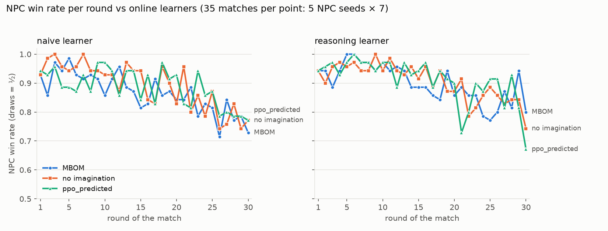

*Figure 6.6. NPC win rate per round against the naive and reasoning learners (35 matches per point). Source:
`results/mbom/adaptive_test/win_rate_by_round.csv`.*


## 7. Human evaluation

> **[PLACEHOLDER: results to be added after data collection.]** We have **not** yet tested the NPC on real players, so this
> report makes no claim that it works on people. The human study is the direct test.

**Planned design.** The code is ready (`scripts/human_eval.py`, `scripts/analyze_human.py`, `configs/human_eval.yaml`):

1. Each participant plays a short **practice** match (3 rounds) against the Training Dummy to learn the controls.
2. They then play two blind opponents, **A** and **B**, which are the hand-written NPC and `ppo_predicted` (SEER). The
   order is **counterbalanced** by participant ID, and names, panel and music are hidden (`--blind`).
3. Each opponent is played in 2 matches of 10 rounds, back to back.
4. After each match the participant gives a 1–5 difficulty rating (they may skip).
5. Only a participant ID is stored. The real NPC version is logged for analysis.

**What we will analyse.** The participant's win rate per round, how it changes over a match, and the difficulty ratings,
for A against B. With so few participants the intervals will be wide, so the analysis is labelled exploratory. A
well-predicting NPC should reduce the human win rate, and the question is whether the reduction appears and grows over
the rounds.

[TODO: need number] (number of participants, results table and figure: `results/human/human_summary.csv`,
`human_eval.png`)

[TODO: confirm design] `PLAN.md` Decision 18 describes 5–8 participants × 3 matches × 10 rounds against MBOM, while
`configs/human_eval.yaml` runs A/B against the hand-written NPC and `ppo_predicted`. This section follows the code.


## 8. Discussion, limitations and future work

### 8.1 What the results say

The straightforward parts worked. Our predictor reads scripted players well and does not see patterns that are not there.
A learned NPC that sees the prediction beats a hand-written one, and our environment model Γ is accurate enough to imagine
with.

The main MBOM idea, **recursive imagination, did not help in our setting**. The reasons we found:

- **The imagined levels predicted these opponents badly.** Against exploiters and learners, φ1 and φ2 sat near chance
  while φ0 learned the opponent. The imagined best response to an NPC that trusts φ0 does not look like what these
  opponents really do. The exploiters are fixed policies trained offline; the learners improve by ordinary PPO, not by
  reasoning about our NPC.
- **The mixer helps but cannot finish the job.** It correctly down-weights the poor levels, but the α cap leaves about 22%
  of the weight on them, which blurs the policy's input.
- **It is not Γ's fault.** With the true rules the result was the same.
- **MBOM's small edge over `ppo_predicted` has another source**: its different schedule for retraining φ0.

The fair summary: *prediction* gave us a working adaptive NPC; *imagination* gave us a cost (a 30-round match took 38 s on average,
against 1.5–2.7 s for `ppo_predicted`) without a gain.

### 8.2 Limitations and caveats

We want these to be hard to miss:

- **Exploiter results depend on which checkpoint they trained against.** At NPC seed 0, `ppo_predicted` is much worse than
  `ppo_none`; at seeds 1–4 the exploiters hurt both about equally. Exploiters were trained against NPC seed 0, so seed 0
  and seeds 1–4 are always reported separately.
- **The learners were pretrained against the hand-written NPC**, which favours them in any comparison against that NPC.
- **Win rate saturates near 1.0** against the scripted styles, so those opponents cannot rank the learned NPCs.
- **The lookahead opponent had a floor effect.** All NPCs won only 10–12% of rounds against it, so H2 could say little
  about NPCs that could compete with it.
- **Matches are 30 rounds, a default and not a tuned value.** That gives learners only about 600–1,000 steps, roughly
  0.1% of the exploiters' 1M-step budget, so the learner results describe *early* adaptation. The NPC's win rate was still
  falling at round 30.
- **Matches in a cell share one NPC checkpoint**, so paired tests treat them as independent and understate the
  uncertainty. We have only 5 NPC checkpoints per method.
- **Γ errors compound with the rollout length.** We measured two steps ahead, not more. Reward on the NPC's knockout step
  is the weakest spot (85.9%).
- **The demo ECHO is an approximation.** Its update runs in a background thread and lands a few steps late.
- **Human play runs at 4 steps per second**; the tick rate is for human play only and does not affect training.
- **Draws count as one half** in every win rate.
- **Game balance is imperfect** (weak flanker, many draws among passive styles, a strong counter-puncher against predictable
  styles).
- **KL divergence is uninformative for near-deterministic learner policies**, so we judge the learners by score, damage and
  entropy.
- **Practical gains are small.** Most differences we can call real are under 0.05 in win rate.
- **The human evaluation has not been run.** Whether the NPC feels adaptive to a real person is untested.

### 8.3 Future work

1. **Run the human study** (Chapter 7), which is the most important missing piece.
2. **Lower the mixer temperature** so the cap rises and the mixer can commit to φ0. This is the direct fix for the
   blur, and it was proposed but not run.
3. **Test against opponents that genuinely reason about the NPC** and that the NPC can compete with, so imagination has a
   fair chance. The lookahead opponent was too strong for that.
4. **Longer matches and learners with more experience**, to see where adaptation ends up.
5. **Retrain the NPC with learner snapshots in its opponent pool** (planned in M9 but not done).
6. **Speed up MBOM updates.** Most time goes to the opponent-model GRU, which is recomputed at every imagined step.
7. **Measure Γ over longer rollouts**, and add a belief over player *types* to the demo panel (planned and skipped).


## 9. Conclusion

We built a small fighting game, a set of opponents from simple scripts to learning players and trained exploiters, and four
NPC brains. A GRU predictor reads the player's habits and a PPO NPC uses its guesses to counter them. A scaled-down MBOM
adds a learned game model, imagined opponents and a Bayesian mixer.

The prediction half of the idea worked. The imagination half did not: MBOM never clearly beat plain prediction, and where
there was a signal it was slightly worse. The Bayesian mixer did earn its place, and we traced the reason imagination
struggled to the poor quality of the imagined opponents and to the mixer's cap, not to the game model. Our results
describe scripted, learning and exploiter opponents. We have **not** shown that the NPC works on real people. The human
evaluation is the direct test, and its results will be added to Chapter 7.

### References

- Yu, X., et al. *Model-Based Opponent Modeling*. NeurIPS 2022. (Base paper; in `references/`.)
- Schulman, J., et al. *Proximal Policy Optimization Algorithms*. 2017.
- He, H., et al. *Opponent Modeling in Deep Reinforcement Learning*. 2016.
- Albrecht, S. V. and Stone, P. *Autonomous Agents Modelling Other Agents: A Survey*. 2018.

[TODO: need number] (full author lists and venues for these references; `references/references.md` has titles, authors and years only)

<p class="pb"></p>

## Appendix A. Setup and run commands

Python 3.12, from the repository root, in PowerShell. Scripts run as modules.

```powershell
# setup
python -m venv .venv
.\.venv\Scripts\Activate.ps1
pip install -r requirements.txt

# install the final models into models\ (full set of commands in the README)
Copy-Item models\final\predictor.pt, models\final\env_model.pt models\
New-Item -ItemType Directory -Force models\npc | Out-Null
Copy-Item models\final\npc\*.pt models\npc\
New-Item -ItemType Directory -Force models\exploiter, models\learners | Out-Null
Copy-Item models\final\exploiter\*.pt models\exploiter\
Copy-Item models\final\learners\*.pt models\learners\

python -m pytest -q                                              # 156 tests, about 1 minute

# play
python -m scripts.play
python -m scripts.play --opponent mbom --panel on
python -m scripts.play --opponent mbom --blind --label B --participant P01
python -m scripts.play --tick-rate 8

# reproduce the results (long runs; every run saves to results/)
python -m scripts.balance_matrix  --config configs/balance.yaml
python -m scripts.train_predictor --config configs/predictor.yaml
python -m scripts.eval_predictor  --config configs/predictor.yaml
python -m scripts.train_npc       --config configs/npc_ppo.yaml
python -m scripts.eval_npc        --config configs/npc_ppo.yaml
python -m scripts.train_env_model --config configs/env_model.yaml
python -m scripts.train_exploiter --config configs/exploiter.yaml
python -m scripts.eval_exploiters --config configs/exploiter.yaml
python -m scripts.probe_cond_shift --config configs/mbom.yaml
python -m scripts.gonogo_mbom     --config configs/mbom.yaml
python -m scripts.dev_variants    --config configs/mbom.yaml
python -m scripts.final_grid      --config configs/mbom.yaml --threads 1
python -m scripts.make_plots      --config configs/mbom.yaml

# human study
python -m scripts.human_eval --participant P01
python -m scripts.analyze_human
```

Every script has a smoke config in `configs/experiments/` that runs end to end in about a minute.

## Appendix B. Repository structure

```
adaptive_npc/   the package
  env/          game core (no Pygame), observations, Gymnasium wrapper, vectorised envs, match runner
  players/      scripted archetypes, learners, lookahead opponent
  models/       GRU predictor, environment model, small online PPO
  npc/          PPO NPC (3 input modes), scripted NPC, live wrappers; mbom/ (levels, imagination, mixer, agent)
  eval/         metrics, experiment runner, balance, predictor and env-model evaluation
  render/, ui/, audio/   Pygame drawing, game shell and human-study session, synthesized sound
configs/        every seed and hyperparameter (YAML); experiments/ holds the smoke configs
scripts/        command-line entry points (python -m scripts.<name> --config ...)
tests/          pytest suite, headless
models/final/   final trained checkpoints
results/        saved metrics, config snapshots and plots per experiment
report/         this report, its figures, and the scripts that build the Word / PDF versions
references/     the MBOM paper and the reading list
```

## Appendix C. Every number in this report and its source

PLAN means `PLAN.md`; "final grid" means `results/m10/final/` and `results/m11/`.

**Game and setup**

| number | meaning | source |
|---|---|---|
| 9×9; 5 HP; 6 stamina; +1 stamina per 2 steps | arena, resources | `configs/env.yaml` |
| 1 damage, cooldown 2; block 1 stamina/step, stun 2; dodge 3 stamina, 2 tiles | actions | `configs/env.yaml` |
| 150 steps per round; 30 rounds per match | round, match length | `configs/env.yaml`; `configs/mbom.yaml`; PLAN Decision 5 |
| ±1, 0, ±0.1 per damage | reward | `configs/env.yaml` |
| 21 | observation size | `adaptive_npc/env/observations.py` |
| 4 steps/s (lowered from 8); 60 fps | human-play tick rate and render rate | `configs/render.yaml`; PLAN Decision 20 |
| 320×240, ×3, 960×720; 16 colours | retro shell | `configs/ui.yaml` |
| about 3 s; 0.79 cap | MBOM update time in the game; cap shown | PLAN Known limitations; README |
| 399,288; 121,940; 80,703; 27,731 steps/s; 10,000 target | environment speed | `results/benchmarks/env_speed.csv`; PLAN M1 |
| 3.0 s / 6.3 s per update; 23–56 s (mean 38) per match; 1.5–2.7 s for `ppo_predicted` | MBOM speed | PLAN M8 benchmark; `results/benchmarks/mbom_speed.csv` |
| about 49 process-hours | final grid compute | README; PLAN M10 |
| 156 tests | test suite | README |

**Balance**

| number | meaning | source |
|---|---|---|
| 200 rounds, seeds 0–2; 45–55%; 65%; 60% | balance design and thresholds | `configs/balance.yaml` |
| 1.000; 0.999; 0.323; 0.494 | first runs | `results/balance/log.md` |
| 0.4825–0.5058 | mirror matches, first slot | `results/balance/slot0_matrix.csv` |
| 0.90; 0.96; 0.65; 0.64; 0.636; 0.010; 0.902; 0.994 | matchups quoted | `results/balance/winrate_matrix.csv`; `report.txt` |
| 20 pairs above 50% draws | passive draws | `results/balance/report.txt` |

**Opponents and models (settings)**

| number | meaning | source |
|---|---|---|
| noise 5%; radius 2; poke 30%; 8-step pattern; 25% / 20%; 10 rounds; delay 1, noise 20% | archetypes | `configs/players.yaml` |
| learning rates 3×10⁻⁴, 10⁻³, 3×10⁻³; every 32 / 64; chosen 3×10⁻⁴ / 64 | learner sweep and choice | `configs/learners.yaml`; `results/learners/main/chosen.csv` |
| 600–1,000 steps per match | learner experience | PLAN Known limitations |
| 1M steps; seeds 0–2; NPC seed 0 | exploiters | `configs/exploiter.yaml` |
| k = 2; 16 continuations; 5% | lookahead | `configs/mbom.yaml` |
| 8 steps; 64 units; every 25 steps, 3 steps, 256 examples; 7 sweep options | predictor | `configs/predictor.yaml` |
| 2M steps; 5 seeds; 64-unit layers | PPO NPC training | `configs/npc_ppo.yaml` |
| 15 numbers; 0%; 86.7k; 34.3k; 23.2k; 57.7k; 40% | Γ and its data | `models/env_model.py`; PLAN M7 |
| 3 levels; every 50 steps, lr 10⁻³; k = 2; 16; T = 0.5; ≈ 0.787; 22% | MBOM | `configs/mbom.yaml`; PLAN M8 |
| 20 seeds; step 17; median 50 | mixer on synthetic data | PLAN M8 |

**Results**

| number | meaning | source |
|---|---|---|
| 0.91; 0.96; 0.91; 0.88; 0.73; 0.217; 0.25; 0.86; 0.47; 0.61 | predictor accuracy | `results/predictor/main/metrics_per_archetype.csv`; README |
| 0.35; 0.23; 0.30; 0.25; 0.55; 0.23; 0.35; 0.44 | majority baseline | `results/predictor/main/metrics_per_archetype.csv` |
| 0.877 vs 0.850 | switcher, frozen vs online | `results/predictor/main/metrics_per_archetype.csv` |
| 99.38% / 98.79%; 99.29% / 98.63%; 98.89% / 97.27%; 99%; 85.9% | Γ accuracy | `results/env_model/main/`; PLAN M7 |
| 0.563, 0.683; 0.993, 0.903; 1.000, 0.973; 1.000, 0.980; 1.000, 0.947 | held-out styles | PLAN M10 held-out table (`results/m11/heldout_table.csv`) |
| 0.051, 0.584, 0.909; 0.007, 0.767, 0.920 | NPC vs naive / reasoning learner | `results/m10/final/methods.csv` |
| 0.00 → 0.45–0.96 | exploiters before and after | PLAN M9 |
| +0.046 ± 0.130; −0.311 ± 0.072; −0.199 ± 0.107; +0.207 ± 0.085; +0.325 ± 0.112; +0.858 ± 0.031; +0.152 ± 0.105; +0.913 ± 0.031 | exploratory comparisons | `results/m10/final/comparisons.csv`; PLAN M10 |
| 1.4 points; 0.16 → 0.44 HP | conditioning probe | PLAN M8 |
| +0.004 ± 0.034; −0.050 ± 0.031 | go/no-go | `results/mbom/gonogo`; PLAN M8 |
| 0.783; 0.178; 0.206; 0.270; 6% | level accuracy, untouched copy, argmax flips | PLAN M8 diagnosis |
| +0.003 ± 0.021; −0.003 ± 0.012; −0.119 ± 0.054; −0.202 ± 0.050 | dev variants | `results/mbom/dev_variants.csv` |
| −0.011 ± 0.020; 105 matches; 0.87–0.93 | H1 | `results/mbom/adaptive_test/summary.csv` |
| −0.007 ± 0.041; 0.116, 0.122, 0.098; 4.7 of 5 HP | H2 | `results/mbom/h2_lookahead/summary.csv` |
| the 12 rows of the claim-group table | final grid | `results/m10/final/comparisons.csv`; `results/m11/comparisons_table.csv` |
| −0.074 ± 0.055 | `uniform_mix` − mbom, reasoning learner | `results/m10/final/comparisons.csv`; PLAN M10 |
